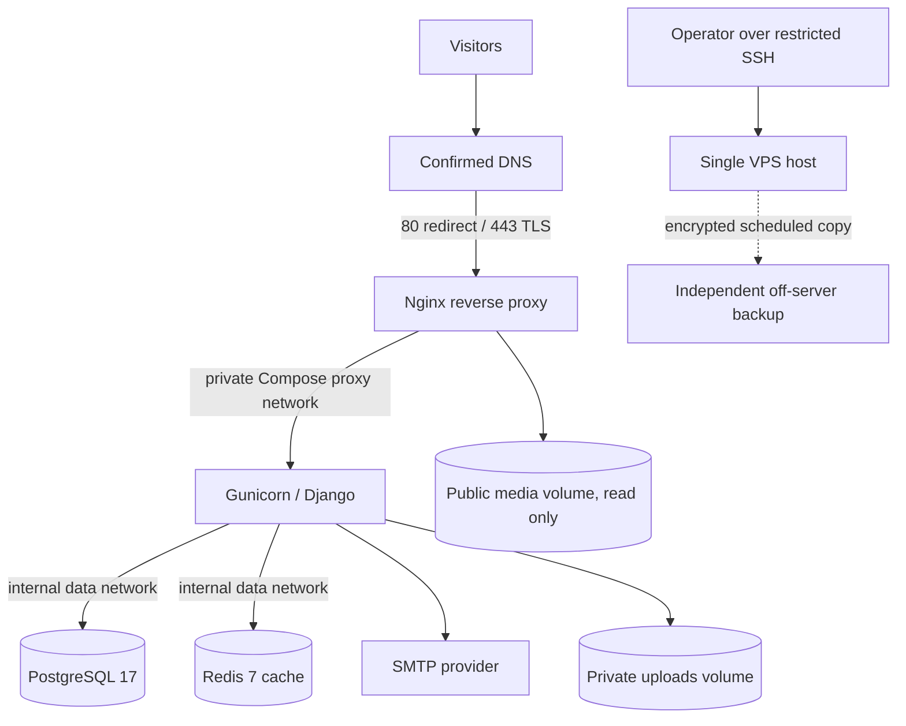

# Codeventra Labs production architecture proposal

**Status:** design and isolated templates only. Nothing in this document means the site is deployed. Domain ownership, DNS, hosting account eligibility, infrastructure, SMTP, certificates, and production secrets remain unconfirmed.

## Target topology

One VPS is a cost-conscious starting point for a low-traffic agency portfolio. It is a single failure domain and provides no high availability. A host, disk, region, account, or operator error can make every service unavailable at once. Keep a migration path to managed PostgreSQL, external object storage, and a second application host/load balancer when uptime, load, or recovery needs justify the added cost.

## Service responsibilities and boundaries

| Service | Responsibility | Exposure and persistence |
| --- | --- | --- |
| Nginx | TLS termination, HTTP redirect, request limits, proxy headers, public media | Only service publishing TCP 80/443. Public media mounted read-only. |
| Gunicorn/Django | Website, admin, contact handling, WhiteNoise static assets | Port 8000 is Compose-only; non-root image; read-only root filesystem; persistent private uploads. |
| PostgreSQL | Primary application data | `data` network only; persistent named volume; no host port. Strong unique credentials. |
| Redis | Rate-limit/cache data | `data` network only; no host port; authentication and memory cap. Cache is disposable; persistence disabled. |
| SMTP | Contact email delivery | Outbound from web only; provider TLS/auth settings and delivery must be verified. |

The proposed Compose file separates an `internal: true` data network from the Nginx-facing proxy network. PostgreSQL and Redis are only on the internal network. Gunicorn has no published host port. Nginx alone publishes 80/443. Do not expose the Docker daemon or mount its socket into containers. Compose is not a substitute for a host/provider firewall: permit inbound 80/443 and SSH (22 or a deliberately changed port), restrict SSH source addresses where practical, and deny other inbound ports. Do not apply firewall changes in this phase.

The production proxy network pins Nginx to `172.20.0.10`, matching the existing trusted proxy IP in Django middleware. Check for host/network conflicts before deployment. Django proxy protocol trust remains unset in current settings; only enable it after confirming that Nginx overwrites `X-Forwarded-Proto` and no untrusted client can reach Gunicorn.

## Isolated production configuration

`deploy/compose.production.yaml` is a proposal; it does not alter local `compose.yaml`. It uses persistent named volumes for Postgres, private uploads, and public media, plus explicit image version tags. Before deployment, resolve reviewed image tags to immutable digests and maintain an image update process. Pass configuration from a protected, host-side environment file, never Git. Compose interpolation values must be supplied to the Compose CLI (for example, `docker compose --env-file /etc/codeventra/production.env -f deploy/compose.production.yaml config`); the service `env_file` only injects values into the web container. Compose interpolation may expose resolved secrets in rendered configuration output; only authorized operators should handle that output, and it must not be logged or shared.

The app image must be supplied as an approved immutable registry digest through `APP_IMAGE`. PostgreSQL and Redis use explicitly versioned image tags as a starting pin and should also be digest-pinned by the release owner after reviewing the official images and update policy. Avoid `latest`, `stable`, and other floating tags in a release record.

Migrations are deliberately not in the container start command. For each release, an operator reviews the migration plan and backup state, then runs the approved migration as a controlled one-off operation. Application restarts do not run migrations. Migrations that require an incompatible schema transition need an expand/contract release plan.

The application image creates `/app/private_uploads` and `/app/media` for UID 10001 before switching to its non-root user. New named volumes are initialized from those image directories by Docker's volume-copy behavior. Confirm ownership and writable access with a disposable deployment rehearsal before production; do not recursively change ownership on live data without a reviewed recovery plan. Nginx mounts only public media read-only. It never mounts the private attachment volume. WhiteNoise serves static files from the image.

Redis is a bounded, authenticated, no-persistence cache (`allkeys-lru`). Confirm that current application behavior treats the Redis contents as disposable and that rate limiting still works under eviction before launch. If Redis later stores queues, sessions, or other durable work, redesign persistence and eviction before using it for that purpose.

## DNS, HTTPS, and proxy rollout

Certificate file paths in `deploy/nginx/production.conf.example` are placeholders. The template is not loadable as-is and must not be activated before a valid certificate and real hostnames exist. Start with a separate reviewed HTTP-only bootstrap configuration to verify reachability and obtain the certificate; then install the TLS server and redirect configuration. Select and test an ACME challenge method and renewal automation; do not assume the example provisions certificates.

Safe order:

1. Confirm control of the chosen domain and decide canonical hostnames.
2. Provision the approved server and verify account eligibility, region, capacity, and costs.
3. Configure DNS records and verify propagation and ownership.
4. Verify inbound HTTP reachability and firewall behavior.
5. Obtain a valid certificate through the selected ACME/DNS challenge procedure; configure and rehearse renewal.
6. Validate Nginx TLS, host forwarding, and that `X-Forwarded-Proto` is overwritten from `$scheme`.
7. Confirm Gunicorn cannot be reached directly from the public interface.
8. Only then configure Django `SECURE_PROXY_SSL_HEADER` for the verified proxy header.
9. Enable `ENABLE_HTTPS=True`, secure cookies, and SSL redirects after checking the real hosts and CSRF origins.
10. Consider HSTS only after stable HTTPS operation. Start with an approved short duration; keep subdomain and preload flags off until every subdomain and policy requirement has been reviewed. Never enable preload automatically.

The Nginx template overwrites `Host`, `X-Real-IP`, `X-Forwarded-For`, `X-Forwarded-Proto`, `X-Forwarded-Host`, and `X-Forwarded-Port`. Body size is limited to 6 MiB, matching the existing application upload cap plus multipart overhead. Nginx denies dotfiles and environment/Git/private-upload paths and disables directory listing. Public media is intentionally served from its separate read-only volume. No private attachments or `.env` path is mounted there.

## Django production settings plan

The existing Phase C3 `DEPLOYMENT_MODE` controls production-only, network-free Django checks. Keep local defaults unchanged. In a future approved deployment, provide:

| Setting | Production plan |
| --- | --- |
| `DEPLOYMENT_MODE` | `production`; enables deployment checks. |
| `DEBUG` | `False`, explicitly. |
| `SECRET_KEY` | Unique random secret, at least 50 characters under existing checks; store in protected host configuration. |
| `ALLOWED_HOSTS` | Exact confirmed public hostnames only; no wildcard or localhost. |
| `CSRF_TRUSTED_ORIGINS` | Exact HTTPS origins, each hostname also in `ALLOWED_HOSTS`. |
| `ENABLE_HTTPS` | `True` only after certificate, proxy, and direct Gunicorn isolation are verified. This enables redirects and secure cookies in current code. |
| `SECURE_SSL_REDIRECT`, secure cookies | Derived by current settings from `DEBUG=False` and `ENABLE_HTTPS=True`; confirm at rollout. |
| `SECURE_PROXY_SSL_HEADER` | Currently `None`. Configure only after verifying the trusted Nginx overwrite and network boundary. |
| `USE_X_FORWARDED_HOST` | Leave false; Nginx supplies the canonical `Host`. |
| HSTS | Current `HSTS_SECONDS` default is zero, with subdomains/preload false. Introduce gradually after stable HTTPS. |
| Referrer and security headers | Current strict-origin-when-cross-origin, nosniff, and `X_FRAME_OPTIONS=DENY` protections remain. Review deploy-check results. |
| Database | PostgreSQL URL to the private service with strong unique credentials and TLS only if the service boundary requires it. |
| Redis | Authenticated URL to private Redis; do not publish its port. |
| SMTP | Verified provider host, port, TLS mode, sender authorization, and protected credentials. |
| Static files | Build-time `collectstatic`; serve versioned manifest assets using WhiteNoise in the immutable app image. |
| Private uploads | Persistent private volume at `/app/private_uploads`; never a public URL or Nginx mount. Back up encrypted. |
| `SEO_SITE_URL` | Set only to the verified HTTPS origin after domain control and public routing work. |
| `SEO_INDEXING_ENABLED` | Keep false until separate launch approval. |

Current settings already leave proxy trust disabled, redirect/cookies disabled until explicitly enabled, HSTS at zero by default, and SEO indexing false. No settings change is required for this design phase. Run production checks with protected values in a later deployment review; do not print resolved secrets or activate production mode locally.

## Database, backup, and recovery

PostgreSQL uses a persistent named volume and only the internal network. Restrict administrative access to an authorized operator through a protected local socket/tunnel or one-off maintenance container; never add a public database port. Back up with scheduled logical custom-format `pg_dump`, encrypted before leaving the host, and copy it to independent off-server storage. Back up private uploads separately and encrypt them too. Do not export contact submissions for development or routine QA.

Provider backups/snapshots are useful for fast whole-server recovery, but remain a separate protection from independent logical and file backups. A snapshot alone is not a complete backup strategy. Define a retention schedule (initial proposal: daily logical backups retained 14 days, weekly retained 8 weeks, monthly retained 6 months, subject to privacy and storage review); restrict access and key recovery. Verify each backup's integrity and rehearse restoration periodically into an isolated disposable environment with no route to production. A backup is not proven reliable until a restore rehearsal succeeds.

Proposed initial targets, subject to business approval and rehearsal: **RPO 24 hours** for database and private uploads; **RTO 8 hours** for rebuilding the single VPS and restoring service. These are planning targets, not measured guarantees. Restore the approved image/config, restore database and files, apply only reviewed schema steps, verify health and privacy controls, then switch DNS or service routing if needed. Preserve the original volumes until recovery has been accepted. Keep encryption keys, database/SMTP/app secrets, DNS access, image registry access, and certificate renewal access recoverable by designated operators using a separate protected mechanism.

## Release, health, logging, and rollback

No automatic production deployment is proposed. Use reviewed Git changes, CI/test results, a versioned immutable image, and a manual approval checkpoint. Release sequence:

1. Verify the Django test suite and system checks.
2. Build and identify a versioned image; record its digest.
3. Securely transfer or pull the approved image.
4. Verify recent database and upload backups are readable and off-server.
5. Review migration SQL/plan and compatibility with the running image.
6. Obtain explicit deployment approval.
7. Apply only approved migrations in a controlled one-off command.
8. Start/update the application and proxy containers without resetting volumes.
9. Verify `/health/`, TLS, public endpoints, and logs.
10. Verify a controlled SMTP delivery and private attachment access control without exposing real submissions.
11. Monitor resource use, disk space, HTTP errors, restarts, certificate expiry, SMTP failures, and backup job outcomes.
12. Roll back the image/config if necessary, while assessing schema compatibility separately.

The existing `/health/` is a minimal liveness check; it does not prove database/Redis readiness. Use container health checks and separately observed endpoint checks. Send container logs to stderr/stdout and retain them using a bounded host log policy. Avoid logging contact body, attachment data, credentials, or full request headers. Set alerts for disk usage, memory pressure, restarts, certificate expiry, backup failure, and unexpected public 5xx responses. No monitoring service is selected or priced yet.

Keep the last known-good image and config available. Rolling an image back does not necessarily reverse a database migration. Prefer backward-compatible expand/contract migrations; if a migration is irreversible, the release needs a tested forward-fix or restore plan before approval. Never restore a backup over production as an ad hoc rollback.

## Risks, assumptions, and approval checkpoints

- Domain, ownership, DNS, hosting account eligibility, regional availability, and actual checkout price are unconfirmed.
- One VPS is a single failure domain; no high availability or guaranteed recovery has been demonstrated.
- Capacity estimate assumes a low-traffic portfolio. Monitor memory, CPU, disk, database growth, and upload size before scaling down or up.
- TLS renewal, firewall rules, SSH access policy, backup provider, independent storage, SMTP provider, monitoring, taxes, and retention need owners and implementation plans.
- No backup, restore rehearsal, external endpoint, public email delivery, or production runtime behavior has been verified in this phase.
- Before production: approve domain/provider/cost, secrets and access owners, exact immutable image digests, firewall, certificate/renewal plan, backup storage and retention, RPO/RTO, migration plan, SMTP verification, and SEO activation separately.

## Official planning references

Prices and product availability were checked on 2026-10-28 and are provisional; recheck the provider checkout immediately before purchase. See [hosting cost plan](hosting-cost-plan.md).

- Hetzner Cloud plan details and availability: https://www.hetzner.com/cloud/cost-optimized/
- Hetzner Cloud price adjustment (effective 2026-06-15): https://docs.hetzner.com/general/infrastructure-and-availability/price-adjustment/
- Hetzner IPv4 prices: https://docs.hetzner.com/general/infrastructure-and-availability/ipv4-pricing/
- Hetzner backup and traffic billing: https://docs.hetzner.com/cloud/billing/faq/
- DigitalOcean Droplet pricing: https://www.digitalocean.com/pricing/droplets
